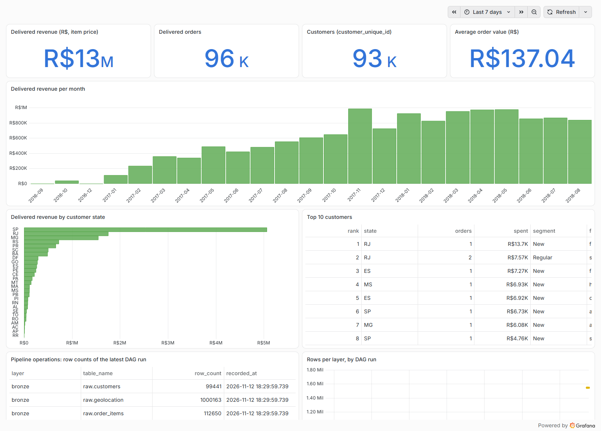

# Olist Data Pipeline

Batch pipeline that turns the Olist Brazilian e-commerce dataset into clean, tested tables for reporting.

**Latest report:** https://phuochuyy.github.io/olist-data-pipeline/

## Overview

- **Data:** [Olist public dataset](https://www.kaggle.com/datasets/olistbr/brazilian-ecommerce), 9 CSV files, about 1.5 million rows (orders, items, customers, products, sellers, reviews, payments, geolocation).
- **Goal:** answer simple business questions (revenue, orders, average order value, best states and customers) from data that has been checked first.
- **Output:** PostgreSQL tables in three layers, a Grafana dashboard, and an HTML report written at the end of every run.



## Architecture

```
CSV --Spark--> bronze (raw) --Spark--> silver (staging) --Spark--> gold (marts)
                   |
                   +-- quality checks: SQL + Great Expectations
                   +-- dbt --> customer mart + analytics tables --> Grafana + HTML report
Airflow runs everything daily (12 tasks).
```

| Tool | Why |
|---|---|
| Spark | loads and joins the CSV files into the bronze, silver and gold layers |
| PostgreSQL | the warehouse that every other tool reads |
| dbt | SQL models for reporting, with tests next to the models |
| Great Expectations | data checks on the raw tables before anything is built on them |
| Airflow | runs the steps in order every day, with retries |
| Grafana | dashboard on top of the warehouse |
| Docker Compose | the whole stack starts with one command |

## How it works

1. **Load:** Spark reads the CSV files into `raw.*`.
2. **Transform:** Spark builds dimensions and an order fact table in `staging.*`, and daily sales and customer metrics in `marts.*`.
3. **Check:** SQL rules and 15 Great Expectations rules run on the raw tables. If a check fails, the run stops.
4. **Model:** dbt builds the customer mart and three analytics tables (revenue by state, by month, top customers) and runs 30 tests.
5. **Report:** row counts of every table go into `monitoring.pipeline_metrics`, and `docs/index.html` is written for GitHub Pages.

## Data quality

| Check | Result on the latest run |
|---|---|
| Great Expectations (not null, unique, allowed values, ranges) | 15/15 passed |
| dbt tests (not null, unique, relationships, ranges) | 30/30 passed |
| Test suite against the warehouse (`tests/automated_test_suite.py`) | 7/7 passed |

## How to run

Needs Docker with about 8 GB of memory.

```bash
# 1. Download the data (not stored in git)
curl -L -o olist.zip https://www.kaggle.com/api/v1/datasets/download/olistbr/brazilian-ecommerce
unzip olist.zip -d data

# 2. Start the stack
docker compose up -d --build

# 3. Open Airflow at http://localhost:8080 (admin/admin) and unpause olist_data_pipeline
#    A run takes about 75 seconds. Dashboard: http://localhost:3000 (admin/admin)

# 4. Stop
docker compose down
```

## Lessons learned

- **`customer_id` is not the customer.** Olist creates a new `customer_id` for every order; `customer_unique_id` is the person. Grouped by `customer_id`, nobody ever orders twice. Grouped correctly: 93,358 customers, 2,801 of them repeat buyers.
- **Average order value = revenue / orders.** The items table has one row per item, so a plain average over rows gives the average item price instead.
- **Next steps:** incremental loads instead of full reloads, and alerts when a check fails.

This is a portfolio project on a public dataset, with local demo passwords only.
